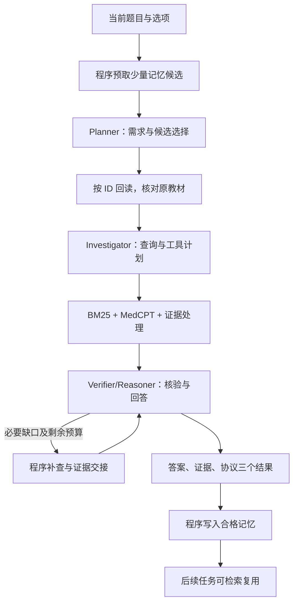

# 系统设计

主线是三个模型角色与程序工具的协作：Planner 分析当前问题和信息需求，Investigator 制定查询计划，Verifier/Reasoner 阅读证据、核验条件并回答。三个角色复用同一生成服务，各有独立提示；检索器、证据处理器、计算与记忆服务均为程序组件。

## 五个模块

| 模块 | 代码 | 实际职责 |
| --- | --- | --- |
| 多 Agent 运行时 | `LangChain/medqa/runtime.py` | 角色顺序、工具决策执行、可选补查、题内调用/时间/Token保护。 |
| 协议解析与调度 | `LangChain/protocol/g2cp.py`、`LangChain/medqa/g2cp_profile.py` | Control 保存调度和能力信息，Semantic 保存引用，Precise 保存本次角色实际需要的输入；程序检查输出与路由。 |
| 状态交换 | `LangChain/medqa/memory.py` | 主进程用 `send_bytes` 发送 float32 向量，独立记忆进程通过 `recv_bytes`/`numpy.frombuffer` 恢复并用于相似度计算。 |
| 共享记忆 | `LangChain/memory/advanced.py`、`LangChain/medqa/memory_units.py` | SQLite持久化、版本/来源/可见性检查、向量召回与按ID回读。 |
| 评测与恢复 | `LangChain/medqa/cli.py`、`checkpoint.py`、`results.py` | 独立选项评分、真实usage、逐题指标、调用和工具操作账本、待提交记忆及恢复。 |

## 通信与状态

文本和结构化条件共用角色、业务字段、工具、证据处理及预算。输入分别渲染为字段可读文本或紧凑JSON；输出均是JSON决策。比较结果不能推广成任意自然语言对话与全部协议机制的独立因果收益。

向量在运行时与记忆服务进程之间交换，用于候选检索。控制信息单独传递；统计中的向量字节不包含全部Pipe帧头与控制元数据。当前未实现LLM隐藏状态或KV cache注入，也未将Pipe称为Linux共享内存。

## 三类记忆

| 类型 | 内容 | 使用方式 |
| --- | --- | --- |
| evidence | 来源核对的教材引句、来源ID、版本和历史条件 | 回读原教材后放入证据池，仍需当前条件适用性判断。 |
| strategy | 实际查询、检索观察与执行反馈 | 提示调查策略，不作为医学事实。 |
| episode | 历史需求、缺口、来源与结束状态 | 辅助分析历史过程，不作为事实证据。 |

统一记录ID、来源Agent、创建时间、主题、摘要、类型和来源任务。`basic`策略允许保存合格片段及过程观察，不要求整题全部被证据支持。标准答案和评分结果不进入知识记忆。

当前needs策略先在程序侧粗召回，再限制投递的候选数和摘要长度；Planner选择ID，程序按需回读。相似度、来源有效、实际引用和正确复用是不同指标。

## 调用及可靠性边界

当前配置正常主路径三次模型调用，允许一次可选Reasoner更新，最多四次；只有具体缺口、新增可见证据和剩余资源均满足才追加更新。所有实际调用计入usage。

结果和待写入记忆先持久化，再提交记忆；后续任务只能看见已提交单元。恢复使用已保存的模型响应和工具产物，来源/配置/源码变化时停止。远程API和本地磁盘不能原子提交，响应未知时保留未知成本，不自动当作零费用。
