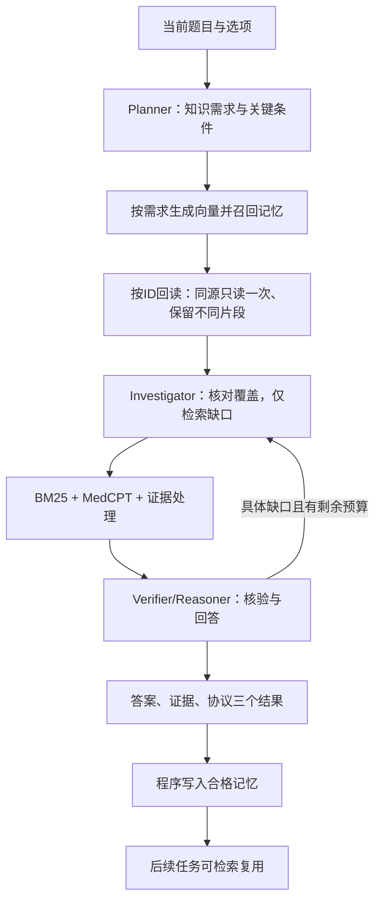

# 系统设计

主线是三个模型角色与程序工具的协作：Planner 分析当前问题和信息需求，Investigator 制定查询计划，Verifier/Reasoner 阅读证据、核验条件并回答。三个角色复用同一生成服务，各有独立提示；检索器、证据处理器、计算与记忆服务均为程序组件。

新增可选应用层共享工作状态与角色视图：`workspace_policy=role_views_v1`。仅structured启用，Text保留原交接；细节、回退条件与统计边界见[共享工作状态](SHARED_WORKSPACE.md)。

## 五个模块

| 模块 | 代码 | 实际职责 |
| --- | --- | --- |
| 多 Agent 运行时 | `LangChain/medqa/runtime.py` | 角色顺序、工具决策执行、可选补查、题内调用/时间/Token保护。 |
| 协议解析与调度 | `LangChain/medqa/acp.py`、`handoff.py` | Text 提供自然语言交接；structured 用 ACP-1 编解码、能力校验、类型化引用、批次映射与函数派发。 |
| 状态交换 | `LangChain/medqa/memory.py` | 主进程用 `send_bytes` 发送 float32 向量，独立记忆进程通过 `recv_bytes`/`numpy.frombuffer` 恢复并用于相似度计算。 |
| 共享记忆 | `LangChain/memory/advanced.py`、`LangChain/medqa/memory_units.py` | SQLite持久化、版本/来源/可见性检查、向量召回与按ID回读。 |
| 评测与恢复 | `LangChain/medqa/cli.py`、`checkpoint.py`、`results.py` | 独立选项评分、真实usage、逐题指标、调用和工具操作账本、待提交记忆及恢复。 |

## 通信与状态

文本与结构化条件保留同一角色任务、知识源、工具、证据处理及预算。Text 将已有结果提炼为自然语言交接，绕过 ACP；structured 在 ACP-1 注册任务和证据等对象，通过类型化引用与函数派发处理，接收角色恢复必要模型视图。模型自己的工具/结果输出仍使用 JSON。机制和统计边界见 [实现说明](COMMUNICATION_IMPLEMENTATION.md)。

旧路径中的 `g2cp.py` 是仓库自有的三层对象封装，不等同于论文 Graph-Grounded Communication Protocol。新 MedQA 交接不经过此封装，也没有实现论文的共享知识图谱 TRAVERSE/UPDATE 执行链，详见 [对照核查](G2CP_COMPARISON_AUDIT.md)。

向量在运行时与记忆服务进程之间交换，用于候选检索。控制信息单独传递；统计中的向量字节不包含全部Pipe帧头与控制元数据。当前未实现LLM隐藏状态或KV cache注入，也未将Pipe称为Linux共享内存。

## 三类记忆

| 类型 | 内容 | 使用方式 |
| --- | --- | --- |
| evidence | 来源核对的教材引句、来源ID、版本和历史条件 | 回读原教材后放入证据池，仍需当前条件适用性判断。 |
| strategy | 实际查询、检索观察与执行反馈 | 提示调查策略，不作为医学事实。 |
| episode | 历史需求、缺口、来源与结束状态 | 辅助分析历史过程，不作为事实证据。 |

统一记录ID、来源Agent、创建时间、主题、摘要、类型和来源任务。`basic`策略允许保存合格片段及过程观察，不要求整题全部被证据支持。标准答案和评分结果不进入知识记忆。

上图为当前50题配置的need_first流程：Planner先规划，不阅读历史候选；随后程序按知识需求召回证据并限额回读，Investigator复核覆盖。need_first只晋升合格证据，strategy/episode保留过程日志。legacy仍支持旧候选先行路径。相似度、来源有效、实际片段引用和正确复用分别计量，详见[需求驱动记忆](NEED_FIRST_MEMORY.md)。

## 调用及可靠性边界

当前50题need_first配置正常主路径3次模型调用，最多3轮调查、7次调用；只有具体缺口、可执行预算及新可见证据满足时追加更新。旧30题legacy配置的正常路径同样为3次，最多4次。所有实际调用计入usage。

结果和待写入记忆先持久化，再提交记忆；后续任务只能看见已提交单元。恢复使用已保存的模型响应和工具产物，来源/配置/源码变化时停止。远程API和本地磁盘不能原子提交，响应未知时保留未知成本，不自动当作零费用。
